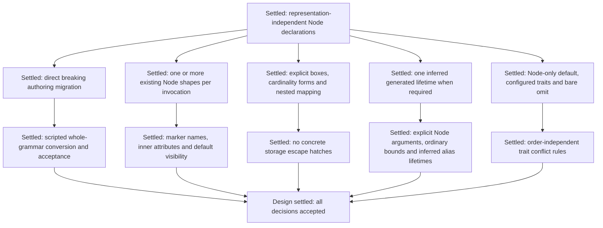

# AST Node declarations

Status: implemented and validated for nested AST output.
This document is the declaration and nested-output contract.

## Settled requirements

- Node declarations are the canonical source. Nested and flat ASTs are concrete representations,
  neither of which supplies the other's schema. See
  [ADR 0010](adr/0010-declare-nodes-independently-of-ast-representation.md).
- Use `ast_node!` as the macro-based declaration surface.
- The macro replaces concrete structs/enums with `Node` derives as the destination authoring
  surface in a direct breaking change, without temporary mixed authoring. pg-sql is the only
  current consumer and is co-developed with Recursa. Diagnose retired authoring syntax with an
  actionable migration message.
- Deliver a conversion script that migrates pg-sql's entire grammar in one invocation. The
  grammar is large: do not spend LLM tokens rewriting Nodes individually. Implement and verify
  the mechanical transformation in the script, then run it over the grammar as a whole.
- One invocation may contain one or more structs/enums. Generate their declared names in the
  surrounding module; handwritten implementations remain ordinary Rust outside the invocation.
- Support the outer macro through its qualified facade path and ordinary imports/renames.
  The inner `boxed!`, `one_or_many!`, and `zero_or_many!` forms are fixed declaration-only
  markers, requiring no imports and offering no independently callable macro API.
- Preserve currently supported named, tuple, and unit structs, all corresponding enum variant
  forms, generic Nodes, and `Self` references. Adding const-generic Nodes is out of scope.
- Preserve ordinary Rust type bounds and `where` clauses as opaque Rust syntax. Require
  explicit type arguments for Node applications and reject defaulted Node type parameters;
  preserve existing supported type-alias defaults separately.
- Default omitted type and struct-field visibility to `pub`. Respect explicit Rust visibility
  restrictions such as `pub(crate)` and `pub(super)`; enum fields follow Rust's inherited
  visibility rules.
- Put docs, derives, and grammar attributes inside the invocation on the intended declaration,
  variant, or field. Outer `cfg`/`cfg_attr` may gate the whole invocation; do not broadcast outer
  documentation or behavior attributes across enclosed Nodes.
- Express one-or-more and zero-or-more cardinality with `one_or_many!(T)` and
  `zero_or_many!(T)`. The concrete collection depends on cardinality and AST representation.
- Optional fields use concrete `Option<...>`.
- Reject concrete storage constructors (`Box`, `Vec`, `Vec1`, and their arena equivalents)
  inside declarations, including through aliases. Preserve aliases to otherwise supported
  field shapes and validate their resolved meaning; the prohibition concerns container identity,
  not coincidental identifier spelling.
- Authors place indirection explicitly with `boxed!(T)`; the AST style chooses the concrete
  kind of box. Do not infer boxing merely because a declaration is recursive.
- Retain grammar-wide `arena_ast` selection for nested output. Use ordinary containers without
  it and arena-backed containers with it, consistently across generated declarations and
  construction.
- Retain the existing cardinality restrictions: `T`, `Option<T>`, `one_or_many!(T)`,
  `zero_or_many!(T)`, and `Option<one_or_many!(T)>`, with `boxed!` layers anywhere. Optional
  zero-or-more lists and nested repetitions are rejected. Diagnose recursive layouts that lack
  sufficient authored indirection.
- Render the required lifetimes in the final generated AST, avoiding input/storage lifetime
  boilerplate at the declaration site. Generated Rust types still expose their required lifetimes.
- Use one inferred lifetime named `'input` per generated Node type when required, and otherwise
  keep the type lifetime-free. Explicit Node lifetime parameters are disallowed; independently
  authored multi-lifetime Node signatures are retired.
- Insert a configured or default derive set automatically; an explicit
  `#[derive(recursa::Node, ...)]` is unnecessary.
- With no trait configuration, generate mandatory Node support only. Other traits are opt-in
  through grammar-wide defaults or local additions.
- Keep grammar-wide `derives(...)` and per-node configured additions. Support standalone
  `#[omit(...)]` on a declaration to suppress inherited configured implementations, allowing
  handwritten implementations to supply them.
- Retire `#[node(omit(...))]` with a diagnostic pointing to `#[omit(...)]`. Retain
  `#[node(derive(...))]` for configured local additions and ordinary `#[derive(...)]` for
  explicit Rust derives.
- Forward ordinary Rust `#[derive(...)]` and its helper attributes, including third-party
  derives. Trait selection is independent of attribute order and follows the conflict rules below.
- Flat AST variant design is out of scope for this session.

The motivating declaration is:

```rust,ignore
ast_node! {
    struct TypeNameIdent {
        #[sep(DOT)]
        parts: one_or_many!(crate::tokens::type_name_ident),
    }
}
```

For the existing nested arena representation, the motivating concrete shape is:

```rust,ignore
pub struct TypeNameIdent<'input> {
    #[sep(DOT)]
    pub parts: recursa::ArenaVec1<'input, crate::tokens::type_name_ident<'input>>,
}
```

The example omits lifetime parameters on both the declaration and the token reference. Generation
supplies the lifetimes required by the selected AST style and referenced types using the single
generated `'input` convention.

An explicitly boxed recursive declaration is:

```rust,ignore
ast_node! {
    enum Expr {
        Name(crate::tokens::ident),
        Neg(boxed!(Expr)),
    }
}
```

This records authored indirection without fixing its concrete Rust container.

## Nested output mapping

| Declaration | Ordinary nested AST | Arena-backed nested AST |
| --- | --- | --- |
| `boxed!(T)` | `Box<T>` | `ArenaBox<'input, T>` |
| `zero_or_many!(T)` | `Vec<T>` | `ArenaVec<'input, T>` |
| `one_or_many!(T)` | `Vec1<T>` | `ArenaVec1<'input, T>` |
| `Option<T>` | `Option<T>` | `Option<T>` |

Paths are abbreviated here. Each referenced `T` also receives whatever lifetime arguments its
generated type requires, using `'input` where a generated Node needs a lifetime parameter.

Supported compositions include:

```rust,ignore
Option<one_or_many!(T)>
one_or_many!(boxed!(T))
boxed!(Option<T>)
```

`Option<zero_or_many!(T)>` and `one_or_many!(zero_or_many!(T))` are rejected.

## Flat output mapping

A grammar root that declares `flat` gets a second representation beside the nested one. Every
declaration then also receives a lifetime-free `Copy` type named `Flat{Ident}`, in the
declaration's own module and at its own visibility. The mapping is in
[the flat AST design](flat-ast-design.md).

`#[flat(pool)]` on a whole struct or enum puts every application of that declaration in its own
typed pool. `#[flat(pool, max_size = N)]` adds a generated assertion that the flat type is at most
`N` bytes. A declaration without the attribute reaches the grammar's shared pool.

```rust,ignore
ast_node! {
    #[flat(pool, max_size = 16)]
    pub enum Expr {
        Name { name: Name },
        Neg(boxed!(Expr)),
    }
}
```

The attribute belongs on a declaration, not on a variant or a field, because a typed pool holds
every Node of one type. A pooled declaration must be publicly reachable, because the generated
owner names one pool field per pooled application. `#[flat(...)]` in a grammar whose root omits
`flat` is an error.

The accepted omission surface is:

```rust,ignore
ast_node! {
    #[omit(PartialEq, Eq)]
    struct TypeNameIdent {
        #[sep(DOT)]
        parts: one_or_many!(crate::tokens::type_name_ident),
    }
}
```

## Generated lifetimes

Infer a Node declaration's need for `'input` from its own storage and the resolved declarations
it directly or transitively references. Do not add a lifetime parameter merely because a generic
type argument can itself borrow input.

For example, a declaration `Wrap<T> { value: T }` generates `Wrap<T>`. A concrete application
can be `Wrap<Name<'input>>` without adding a lifetime parameter to `Wrap`. A declaration with
its own `Name` field needs `'input` independently of its generic arguments. An arena-backed
`List<T>` containing `zero_or_many!(T)` likewise needs `'input` for storage even when `T` is
lifetime-free; its ordinary nested counterpart need not.

Handwritten Rust outside the macro refers to these final signatures, for example
`impl<'input> TypeNameIdent<'input>`. The declaration-only omission rule does not remove
lifetime parameters from the generated API.

Preserve ordinary Rust bounds and `where` clauses without inserting lifetimes inside them.
The generated `'input` name is not available in declaration bounds. Node applications must
supply their semantic type arguments explicitly; Node generic defaults are rejected rather
than introducing new default-argument semantics in this milestone.

### Ordinary type aliases

Aliases remain ordinary Rust declarations outside `ast_node!`, with explicit Rust lifetime
parameters and their existing supported generic defaults. At declaration use sites, omit
lifetime arguments and supply the generated `'input` to every alias lifetime parameter required
by that application. Multiple alias lifetime parameters receive the same inferred lifetime.

```rust,ignore
type MaybeName<'a> = Option<Name<'a>>;

ast_node! {
    struct Root {
        name: MaybeName,
    }
}
```

The generated field is `name: MaybeName<'input>`. Explicit lifetime arguments at declaration
field/Node/token/alias use sites are rejected. An alias fixing source-borrowed content to
`'static` is diagnosed rather than rewritten or used to introduce a static-input grammar.
Validate the supported field shape and storage-constructor restrictions after alias expansion.
Ordinary Rust outside declarations retains its normal explicit lifetime syntax.

## Trait conflict rules

- Omitting a recognized but unselected configured trait is a no-op.
- Omitting mandatory Node support is an error.
- Locally adding and omitting the same configured trait is an error.
- Selecting both a generated implementation and an ordinary derived implementation of the same
  trait is an error.
- `#[omit(Clone)]` together with ordinary `#[derive(Clone)]` is valid: the configured
  implementation is suppressed, leaving the explicitly derived implementation.
- Unknown configured trait names remain errors.

These rules are independent of attribute order. Ordinary Rust derives and handwritten
implementations remain Rust's responsibility after configured implementation selection.

## Design tree



There are no unresolved declaration-design branches. Flat representation design remains outside
this milestone.

## Scripted grammar migration

The conversion script is a required implementation deliverable. A single invocation must convert
the entire pg-sql grammar from the old Node authoring form to the accepted declaration syntax.
"One pass" means one whole-grammar conversion run for the user; the script may analyze the
source tree before emitting edits where resolution or lifetime dependencies require it.

Perform the repeated transformations in code: wrap declarations, replace supported storage
containers with declaration markers, remove declaration-side lifetime boilerplate and redundant
Node derives, and migrate the retired omission spelling. Preserve docs, comments, conditional
compilation, grammar attributes, ordinary derives/helper attributes, explicit visibility intent,
and handwritten Rust implementations under the agreed generated signatures.

Develop the converter against representative cases, then apply it across the grammar. If bulk
validation reveals a missed recurring shape, correct the converter and rerun it; do not use the
LLM to migrate each Node individually. Report the conversion command and its grammar-wide
results so the mechanical migration is reviewable. Existing Rust outside the declarations,
including handwritten implementations and aliases, keeps the lifetime syntax required by the
final generated API.

## Acceptance contract

These observable checks define implementation acceptance. Completed validation is recorded below.

| Area | Required observable result |
| --- | --- |
| Authoring migration | Migrate Recursa's authored grammars, fixtures, examples, and relevant documentation, plus pg-sql, to `ast_node!`; retire old direct `Node` authoring with actionable diagnostics. |
| Conversion script | Deliver and run a script that converts the entire pg-sql grammar in one invocation, preserving authored behavior and reporting the result. No node-by-node migration performed by the LLM. |
| Concrete output | Compile representative ordinary and `arena_ast` outputs with the accepted container mapping, module/name identity, visibility, and inferred lifetime signatures. |
| Shapes and generics | Cover named/tuple/unit structs and enum variants, `Self`, supported generic applications, bounds, aliases, and the agreed restrictions. |
| Semantic field language | Preserve existing Node/token/type-parameter targets and direct `#[presence(...)] bool` fields; do not add arbitrary Rust payload types or new presence/container combinations. |
| Grammar behavior | Preserve recognition, semantic values, parsing entry points, and selected generated capabilities for migrated grammars. |
| Authored behavior | Preserve handwritten pg-sql implementations, third-party derives and helper attributes, grammar annotations, docs, and conditional compilation. |
| Macro resolution | Exercise qualified facade paths, imports/renames of the outer macro, multiple declarations, and fixed inner marker spellings without imports. |
| Diagnostics | Attribute invalid declarations, unsupported containers/cardinality, missing recursive indirection, lifetime/generic errors, and trait conflicts to authored declaration source locations. |
| Repository gates | Pass the required correctness, MSRV, and documentation checks from the repository agent instructions. Keep default runs free of benchmarks, timing assertions, and aggregate reruns. |
| Scope boundary | Flat AST generation, flat storage APIs, flat parsing, conversion between AST representations, and performance measurements remain outside this declaration milestone. |

The existing presence-field exception is retained as part of grammar behavior:

```rust,ignore
ast_node! {
    struct Command {
        #[presence(VERBOSE)]
        verbose: bool,
    }
}
```

Presence still requires a direct unqualified `bool` with its existing annotation contract.
It does not make `Option<bool>`, aliased booleans, or unrelated Rust payload types valid grammar
fields. These are preservation requirements, not a new payload feature.

## Implementation evidence

The declaration front end, concrete nested emission, retired-syntax diagnostics, and authored
grammar migration are implemented. The [converter](../tools/ast-node-converter/README.md) migrated
pg-sql in one invocation: 1,478 declarations, 752 concrete storage constructors, and 3,837
declaration-side lifetime occurrences across 67 source files. It reported no unsupported sites;
a second invocation reported no changes.

Validation completed on 2026-09-15:

| Check | Result |
| --- | --- |
| `cargo test --workspace --all-targets --no-fail-fast` | 666 passed; 4 intentionally ignored |
| `cargo test --workspace --all-targets --all-features --no-fail-fast` | 682 passed; 4 intentionally ignored |
| Rust 1.88 all-target, all-feature check and representative downstream smoke test | Passed |
| Workspace Clippy with all targets/features and warnings denied | Passed |
| All three [documentation gates](agents/documentation.md) | Passed |
| Workspace formatting and diff whitespace checks | Passed |
| Converter tests on Stable and Rust 1.88 | 11 passed on each |
| pg-sql nested grammar, library and integration tests with `arbitrary,spans` | 1,183 passed; 2 ignored |
| pg-sql migration-tool declaration inventory and live validation tests | 2 passed |

The workspace suites ran with localhost access for the explorer server tests. Benchmarks and
manual aggregate evidence were not run. pg-sql validation used an isolated nested-only copy
because its working tree already contained flat-AST work; those eight pre-existing files were
preserved byte-for-byte. Flat generation remains outside this milestone.

## Historical implementation facts

These facts describe the pre-migration implementation inspected during the design interview.
The contracts above specify the intended changes.

- Source discovery currently recognizes authored structs and enums carrying the configured
  facade's `Node` derive. It does not expand `ast_node!`; supporting declarations requires a
  source-analysis boundary as well as the compiler-facing macro.
- Existing semantic containers already normalize ordinary and arena-backed collections to the
  same cardinality. `arena_ast` currently selects the nested arena policy for generated
  construction, while the existing authored Rust types are unchanged. There is no independent
  per-field allocator selection implied by mixing concrete container spellings.
- Boxing is grammar-transparent today, but authored boxes determine concrete nested layouts.
  pg-sql uses boxes both for recursive expressions and inside some collections.
- Current accepted cardinality shapes, ignoring boxes, are `T`, `Option<T>`, `Vec<T>`,
  `Vec1<T>`, and `Option<Vec1<T>>`. The new surface retains those restrictions using declaration
  markers for repetition and boxing. pg-sql uses optional non-empty sequences.
- Some Nodes are lifetime-free even when a parent stores them in an arena-backed collection.
  Lifetime insertion therefore needs target information rather than appending a lifetime to
  every type path.
- Configured trait recipes and ordinary Rust derives are distinct existing mechanisms.
  pg-sql uses third-party derives and helper attributes, while `TypeNameIdent` has handwritten
  equality implementations and an inherent method. Automatic defaults must have a defined
  interaction with authored implementations.
- Current local configured-trait customization uses `#[node(derive(...), omit(...))]`, rather
  than a standalone `#[omit(...)]`. Defaults are empty, an omission of an unselected trait is a
  no-op, and conflicting additions/omissions or duplicate implementation ownership fail.
- Current selected-tree aliases can conceal supported concrete containers; preserving or
  restricting that flexibility was resolved by rejecting concrete storage containers through
  aliases as well as when written directly.
- Existing generic fixtures distinguish `Wrap<T>` from Nodes with their own lifetimes. They
  also include a public `Pair<'left, 'right>`; parse generation fills both positions with the
  same parsing lifetime, but independent lifetime parameters remain part of its concrete API.
- Current Node materialization requires explicit semantic type arguments even when the Rust
  declaration has a generic default. Type-alias defaults have separate, supported resolution.
- Existing `grammar!` and `tokens!` discovery use different macro-spelling rules, so the new
  outer macro's qualified and imported spellings are an intentional contract rather than
  something already provided uniformly by current discovery.
