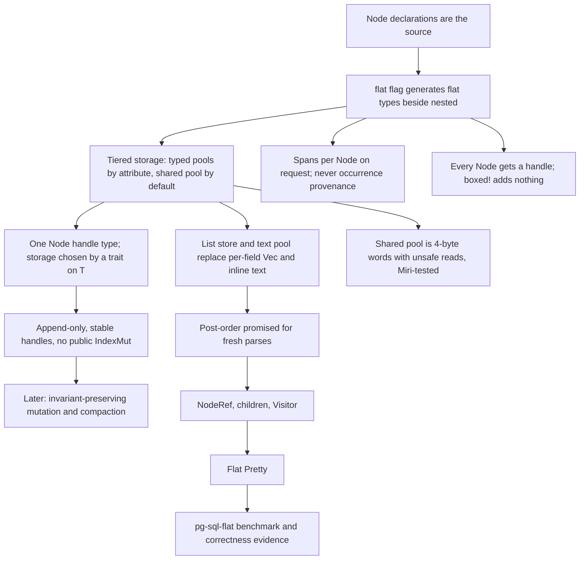

# Flat AST design

Status: tiered storage design settled on 2026-09-16. Implementation follows the order below and
has reached the generated flat types, handles, and layout assertions. Mutation and compaction are
a later milestone.

Decisions: [ADR 0008](adr/0008-keep-flat-asts-semantic-only.md) (semantic-only, amended),
[ADR 0009](adr/0009-give-each-flat-ast-its-own-typed-stores.md) (per-result ownership, partly
superseded), [ADR 0010](adr/0010-declare-nodes-independently-of-ast-representation.md)
(declarations are the source), and [ADR 0012](adr/0012-tiered-flat-storage.md) (tiered
storage). Terms are defined in [CONTEXT.md](../CONTEXT.md).

## Purpose

A Flat AST is a second concrete representation of the same Node declarations that produce the
nested AST. It has three goals:

1. Nodes of a pooled Node type are contiguous in memory.
2. Every child relationship is a four-byte typed handle, not a pointer.
3. Only the Node types an author marks get a typed pool. Every other Node shares one pool.

Recursa generates the storage, the handles, the flat Node types, the construction from LR
reductions, the traversal primitive, and Pretty rendering. Consumer workloads such as name
resolution, type inference, and query rewriting are outside Recursa. They constrain the storage
API and they prove that it is sufficient, but their code does not live here.

## Scope of this milestone

In scope:

- Storage primitives in `recursa-core`, tested under Miri.
- The `flat` grammar-root flag and the `#[flat(...)]` declaration attribute.
- Generated flat Node types, handles, and layout assertions.
- Flat reduce actions and `parse_flat` entry points, with optional per-Node spans.
- `NodeRef`, `children`, `Visitor`, and a debug post-order checker.
- Flat Pretty rendering.
- The `pg-sql-flat` benchmark entry and correctness evidence.

Out of scope, deferred to a later milestone:

- The mutation API. The storage facts it depends on are fixed now (see [Mutation](#mutation)).
- Compaction.
- Flat Explorer support. `NodeRef` and `children` are designed so an adapter can be added.
- A flat `Visit` configured trait. It is a later layer over `children`. `VisitMut` cannot exist
  before the mutation API.

## Storage

One parsed result owns one Flat AST store. The store has four parts and every part is
append-only.

| Part | Contents | Handle |
| --- | --- | --- |
| Typed pool, one per pooled Node application | Every Node of that type, contiguous, in post-order | Node handle |
| Shared pool | Every Node not in a typed pool, as whole 4-byte words | Node handle |
| List store | Every list of handles, each list contiguous | List handle |
| Text pool | Every content token's text | Text handle |

```text
FlatAst<'input>
├── one typed pool per #[flat(pool)] application   (nodes, optional spans)
├── shared pool: Vec<u32>, word 0 reserved          (nodes, optional spans, debug tags)
├── list store:  Vec<u32>, slot 0 reserved          (runs of handles)
└── text pool:   Vec<ContentText<'input>>           (borrowed or owned text, optional spans)
```

### Which Nodes get a typed pool

The author decides per declaration:

```rust,ignore
ast_node! {
    #[flat(pool, max_size = 16)]
    pub enum Expr { /* ... */ }
}
```

- `#[flat(pool)]` puts every application of the declaration into its own typed pool. A generic
  Node gets one pool per materialized application.
- `max_size = N` adds a generated compile-time assertion that the flat Node type is at most `N`
  bytes. Without it the generator only records the size in the generated-code debug bundle.
- A declaration without the attribute lives in the shared pool.
- `#[flat(...)]` in a grammar whose root does not enable `flat` is a diagnostic.

A type belongs in a typed pool when a consumer visits every instance, or keeps a dense side
table over it, or scans it linearly. Do not add a type to a pool without a measurement.

### Handles

All handles are `#[repr(transparent)]` over `NonZeroU32`, so an optional handle is also four
bytes. They use `PhantomData<fn() -> T>` and implement `Copy`, `Eq`, `Hash`, `Debug`, `Send`,
and `Sync` by hand for every `T`. Raw construction is private to `recursa-core`.

- **Node handle** `Handle<T>`: one type for both pools. A generated trait impl on `T` selects the
  storage: for a pooled type the raw value is `slot + 1`; for a shared-pool type it is the word
  offset, which is never zero because word 0 is reserved. Field types do not change when a Node
  moves between pools.
- **List handle** `List<H>`: eight bytes, a non-zero start slot and a length. The empty run is a
  valid value distinct from an absent list. `one_or_many!` maps to a handle type whose length
  cannot be zero; `zero_or_many!` maps to one whose length can. `Option<one_or_many!>` stays
  distinct. `Option<zero_or_many!>` stays rejected.
- **Text handle** `Text<K>`: one text pool per result, typed by the content-token type `K`. The
  pool owns the `ContentText<'input>`, which borrows the input or owns replacement text. Nodes
  hold only the handle, so every flat Node is `Copy`. A consumer that wants interned symbols
  builds them from the text pool into its own table.

Text handles are data, not children. They do not appear in `NodeRef` or `children`.

### Field mapping

| Declaration | Flat field |
| --- | --- |
| `T` (Node) | `Handle<T>` |
| `boxed!(T)` | `Handle<T>` (boxing adds nothing in the flat style) |
| `Option<T>` | `Option<Handle<T>>` |
| `zero_or_many!(T)` | `List<Handle<T>>` |
| `one_or_many!(T)` | `List1<Handle<T>>` |
| `Option<one_or_many!(T)>` | `Option<List1<Handle<T>>>` |
| content token `K` | `Text<K>` |
| `#[presence(...)] bool` | `bool` |

Every Node application gets a handle. No Node is embedded inline in its parent. Named, tuple,
and unit shapes are preserved. Zero-size Nodes in the shared pool take one word; there is no
shared sentinel.

### Shared pool layout

The shared pool is a `Vec<u32>`. Every flat Node has alignment at most 4, because handles are
`u32`, list handles are two `u32`, and `Span` is two `u32`. The generator asserts
`align_of::<T>() <= 4` for every shared-pool Node and rejects a declaration that breaks it. A
Node occupies `ceil(size_of::<T>() / 4)` words, minimum one.

In debug and test builds the word before each Node holds a tag derived from the Node key, and
lookup checks it. Release builds omit the tag.

Reading a shared-pool Node casts an aligned pointer into the word buffer. This `unsafe` code is
confined to one storage module in `recursa-core`, with the typed handle as the only guard. The
value stack in the same crate is the precedent. The module's tests run under Miri in CI.

### Spans

Spans follow the existing request: with the `spans` feature on, `parse_flat` captures and
`parse_flat_without_spans` does not. When capture is on, every Node in both pools and every text
handle has a span. A pooled Node's span lives in a parallel array; a shared-pool Node's span is
written beside its words; a text handle's span comes from its token record. A parent's span is
the extent from its first child or token to its last. Capture off costs nothing.

Flat parsing never builds the occurrence tree. Mandatory occurrence sites do not apply to it.
This amends ADR 0008 from "no spans" to "no occurrence provenance; spans on request".

### Side tables

A side table is a consumer-owned dense array with one value per Node of one typed pool, indexed
by Node handle. Recursa provides the generic type and a `grow` operation; consumers own the
values. A side table cannot cover the shared pool, which is one reason to pool a type.

## Owner API

The generated owner is a grammar-local `FlatAst<'input>` with private fields.

- `root()` returns the root handle.
- `Index<Handle<T>>`, `Index<List<H>>`, and `Index<Text<K>>` are bounds-checked and panic out of
  range. `get(handle)` returns `Option`. No `IndexMut` and no mutable store access is public.
- `span(handle) -> Option<Span>` returns `None` when the parse did not capture. `has_spans()`
  reports the whole result.
- `ids()` on a typed pool iterates its handles in post-order.
- The result is `Send + Sync`, checked at compile time.

## Construction

Flat reduce actions run on the existing LR automaton and value stack. They push handles, not
values. A parent is reduced after its children, so every typed pool is in post-order for a fresh
parse. This is a documented contract: for every Node in a typed pool, every same-pool child has
a smaller index. A debug checker walks `children` over every Node and asserts it.

Lists are built on one scratch stack owned by the parse. Each list-step reduce pushes one
handle; when the parent rule consumes the list, the action copies the run into the list store
and truncates the scratch stack. This works because LR completes an inner list before the outer
list receives its next item, so open lists nest.

Content-token reduces push the token's text into the text pool and return a text handle.

Exhausting a handle's `u32` range is a checked panic with a clear message in every build, as ADR
0009 requires. It is distinct from allocation failure.

## Traversal

The generator emits:

- `NodeRef`: an enum with one variant per Node application, each holding that application's
  handle. It is a traversal value only and is never stored in a Node.
- `children(ast, NodeRef, &mut impl FnMut(NodeRef))`: the direct children in source order.
- `Visitor` with `enter`, which returns `false` to skip children, and `leave`; and `walk`.

Parent links are not stored. A consumer that needs them builds a side table on demand.

## Pretty

Flat Pretty is generated from grammar syntax and declarative Pretty annotations, as the earlier
milestone settled. It does not reuse handwritten nested implementations. An edited Flat AST
renders to SQL that reparses to the same semantic tree; whitespace and comment fidelity are not
required.

## Mutation

The API is deferred until parsing works. Three storage facts are fixed now because they are hard
to retrofit:

1. Pools, the list store, and the text pool are append-only. A replaced Node leaves its old
   storage in place.
2. Handles are stable for the life of the result. No slot is removed, reused, or compacted in
   this milestone.
3. Compaction, when it arrives, is a copying pass into a fresh store that restores post-order
   and returns a remap per typed pool.

Public `ast[handle] = node` is ruled out. It would allow a cycle or a second parent in one line.
The eventual API must make cycles, multiple parents, and invalid handles impossible by
construction, as ADR 0009 requires.

## Invariants

| ID | Invariant | Enforced by |
| --- | --- | --- |
| I1 | In a fresh parse, every same-pool child of a pooled Node has a smaller index. | LR reduce order; debug checker over `children`. |
| I2 | Every handle refers to the store that created it. | API contract; raw construction is private. |
| I3 | For every shared-pool handle, a Node of that type was written at that word. | Typed handle; debug tag. |
| I4 | Every slot of a list run was written from the run's handle type. | The list store is the only writer. |
| I5 | A typed pool and its span array, when present, have equal length. | The pool is the only writer. |
| I6 | Every shared-pool Node has alignment at most 4. | Generated assertion. |
| I7 | A pooled Node with `max_size` is at most that size. | Generated assertion. |
| I8 | A side table has the same length as its pool when read. | `grow` after each append. |

## Design tree



## Implementation order

1. Storage primitives in `recursa-core`: handles, typed pool, shared pool, list store, text
   pool, side table. Unit tests and Miri.
2. The `flat` root flag, the `#[flat(...)]` attribute, and generated flat types with size and
   alignment assertions.
3. Flat reduce actions and `parse_flat`, with the scratch list stack and optional spans.
4. `NodeRef`, `children`, `Visitor`, and the post-order debug checker.
5. Flat Pretty.
6. The `pg-sql-flat` bench entry and correctness evidence.
7. Later milestone: mutation API and compaction.

## Correctness and performance acceptance

- Cover every supported field shape, generic applications, module and type identities, and
  generated Pretty with representative Recursa fixtures.
- Compare nested and flat recognition, consumed input, and diagnostics, including failure
  cleanup. Both paths stay available with `flat` and `arena_ast` enabled together.
- Prove flat-to-SQL-to-nested semantic equivalence.
- Check `Send + Sync`, four-byte optional handles, eight-byte optional list handles, and every
  `max_size` and alignment assertion at compile time.
- Check the handle capacity guard without allocating billions of Nodes.
- Run the post-order checker after every fresh parse in tests.
- Run the storage module under Miri.
- Keep the existing pg-sql differential suite as correctness evidence.

### Benchmark

Extend the existing `parse` target in `../pg-sql/benches/parse.rs` with the engine name
`pg-sql-flat` beside `pg-sql`, `sqlparser`, and `postgres`, under the same timing boundary:
lexing, parsing, and destruction inside each call, identical inputs, no prelexed input for the
flat entry alone. Verify nested and flat acceptance agreement before reporting timings.

```sh
cargo bench -p pg-sql --features postgres-oracle --bench parse
```

The "everything in the shared pool" variant is an opt-in experiment made by removing the pool
attributes. It is not a third engine name and not an acceptance condition. A measured speedup is
not an acceptance condition; correctness and an honest report are.

## History

The earlier milestone design gave every Node type its own `Vec` store, kept content-token text
inline, and planned a bumpalo comparison ([allocation research](flat-ast-allocation-research.md)).
At pg-sql's scale, 1,463 declarations, that is roughly 35 KB of empty vectors per result and one
allocation per type touched, and the research found that per-field child vectors survive
flattening. Tiered storage, the list store, and the text pool answer those findings. The
`ast_node!` migration ([Node declarations](ast-node-declarations.md)) made the flat types
derivable from the same source as the nested types.
