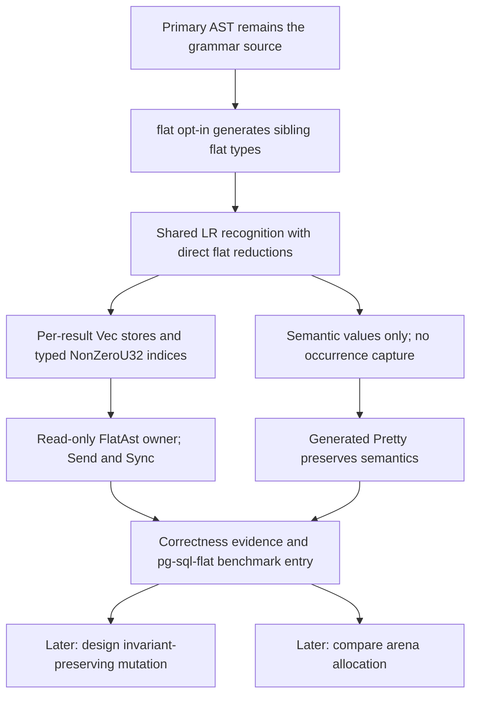

# Flat AST design

Status: parsing-milestone design settled. Implementation has not started. Mutation API design is
explicitly deferred until parsing works.

## Current milestone

Make parsing into the Flat AST work before designing mutation support. The eventual edit-and-render
workflow remains required, but mutation APIs and their implementation are explicitly deferred until
the parser works. Do not turn that future requirement into unrestricted mutable access as a
temporary implementation shortcut.

This milestone includes read-only structural inspection and direct Pretty rendering of unmodified
Flat ASTs. Prove primary/flat parsing agreement, flat-to-SQL-to-primary semantic equivalence,
failed-parse cleanup, and `Send + Sync` through compile-time checks. It is not a mutation milestone.

Completion also includes adding `pg-sql-flat` to pg-sql's existing `cargo bench` parser comparison,
alongside `pg-sql`, `sqlparser`, and `postgres`. A measured speedup is not an acceptance condition;
correctness and an honest performance report are required.

### Decision tree



## Settled decisions

- **Purpose:** experiment with parse performance. No performance benefit or numerical target has
  been established yet.
- **Required workflow:** parse directly into flat storage, edit the Flat AST directly, and render
  the edited result back to SQL without materialising a complete primary tree. Conversion APIs
  are a separate unresolved question.
- **Source of truth:** the current authored, non-flat representation is the **Primary AST**.
  The grammar and parser are derived from it.
- **Derived representation:** generate a corresponding flat version of each primary struct and
  enum through the mechanical transformation below. Preserve named, tuple, and unit variant shapes.
- **Direct construction:** reuse the existing LR recognition engine and tables. Generated flat
  reductions insert Nodes into typed stores and return indices; no intermediate primary AST is
  built. Construction metadata must still agree with the flat reducer's value-stack behavior.
- **Semantic storage only:** retain literals, identifiers, and semantic presence booleans.
  Syntax-only tokens, spans, occurrence provenance, and comments are not stored. Content-token
  values stay inline initially instead of acquiring separate indexed stores.
- **No occurrence capture:** flat parsing does not build an occurrence sidecar, including for
  sites that would request mandatory provenance in the primary parser.
- **Rendering contract:** edited Flat ASTs render to SQL that reparses to the same semantic tree.
  Whitespace and comment fidelity are not required; comments are not captured at all.
- **Storage ownership:** each parsed result owns its typed Node collections and a typed root
  index. Use standard `Vec` stores for the first working parser. Arena allocation is a later
  comparison against that baseline, not a prerequisite to implementing parsing.
- **Text ownership:** parsed content tokens borrow the input. Inserted or replaced content tokens
  can own text, using the existing token model; flattening introduces no text copying.
- **Editable topology:** the root-reachable structure is a tree. Each non-root Node has one
  parent and there are no cycles. A subtree can be moved; using a copy in another location requires
  copying its Nodes.
- **Index ownership:** use compact, type-specific indices without a runtime owner tag. Raw
  construction is private and lookup is bounds-checked; an index belongs to one result by API
  contract. An in-range index from another result cannot be detected by its stored bits alone.
- **Index encoding:** use `#[repr(transparent)]` typed wrappers around `NonZeroU32`, encoding
  the zero-based slot as `slot + 1`. Both an index and an optional index occupy four bytes. Each
  typed store can represent at most `u32::MAX` Nodes; capacity exhaustion must fail explicitly
  before conversion, addition, or truncation can corrupt an index.
- **Capacity guard:** retain the existing `ParseError` return type for ordinary parsing failures.
  Exhausting the index encoding triggers a checked panic with a clear message, including in
  release builds. Do not introduce a separate public `FlatParseError` or silently wrap indices.
- **Slot lifetime:** retain slots until the entire result is dropped. No slot removal, reuse, or
  compaction is planned initially, so indices remain stable. Disconnected Nodes may remain stored
  after eventual edits; mutation mechanisms are not being designed in this milestone.
- **Mutation safety requirement:** the future mutation API must make cycles, multiple parents,
  and invalid indices impossible to introduce through that API. Allowing arbitrary edits followed
  by validation before rendering was explicitly rejected. Defer the mechanism until parsing works.
- **Thread guarantees:** the Flat AST must implement `Send` and `Sync`. Allocation/ownership
  choices must preserve those guarantees.
- **Generation opt-in:** a `flat` flag on the main grammar macro opts into generating the derived
  Flat AST. In the existing macro syntax this is a grammar-root option on `recursa::grammar!`;
  it adds Flat AST generation while existing primary parsing remains available.
- **Parsing entry points:** when `flat` is enabled, add `Type::parse_flat(...)` for each currently
  parseable Node application. Preserve existing recognition, prefix acceptance, and diagnostic
  behavior, while always omitting occurrence provenance.
- **Existing arena option:** allow `flat` and `arena_ast` together. `arena_ast` continues to
  control primary output; the flat path uses its own standard-vector storage.
- **Generated names:** emit `FlatItem` and `ItemIndex` beside the corresponding primary `Item`.
  Preserve existing public visibility and diagnose generated-name collisions explicitly. Private
  fields are a compatibility detail, not a separate design workstream.
- **Read-only owner API:** expose a grammar-local `FlatAst<'input, RootIndex>` with private stores.
  `root()` returns a shared reference to the root record, `root_index()` returns its typed index,
  and `get(index)` returns an optional shared reference to the corresponding typed record.
  Lookup is bounds-checked; no mutable store access is exposed by this milestone.
- **Flat Pretty:** generate rendering from grammar syntax and declarative Pretty annotations,
  independently of primary trait selection. Do not reuse handwritten primary Pretty implementations;
  leave primary rendering unchanged.

The planned opt-in follows existing grammar-root flags:

```rust,ignore
recursa::grammar! {
    module = crate::grammar,
    flat,
}
```

This is proposed syntax to implement, not a flag already accepted by the current generator.

### Field transformation

For a Node application `Item`:

| Primary field type | Flat field type |
| --- | --- |
| `Item` | `ItemIndex` |
| `Box<Item>` | `ItemIndex` |
| `Option<Item>` | `Option<ItemIndex>` |
| `Vec<Item>` | `Vec<ItemIndex>` |
| `Vec1<Item>` | `Vec1<ItemIndex>` |

Apply the rule within struct fields and enum variant payloads. Remove boxes around relationships
that become indices and preserve the remaining supported container structure. Content-token
values and presence booleans remain inline. Generated types retain the original module context
and the existing distinctions between concrete generic applications; no new arbitrary generic
instantiations are introduced. Parser-internal Pratt states do not create new semantic Node types.

The source-of-truth decision is recorded in
[ADR 0007](adr/0007-derive-flat-asts-from-the-primary-ast.md), and the deliberate omission of
provenance is recorded in [ADR 0008](adr/0008-keep-flat-asts-semantic-only.md). Definitions live in
[CONTEXT.md](../CONTEXT.md). Per-result storage ownership and tree semantics are recorded in
[ADR 0009](adr/0009-give-each-flat-ast-its-own-typed-stores.md).

## Existing constraints and implementation facts

- [ADR 0005](adr/0005-sole-lr-parser.md) establishes one Recursa parser. Flat AST construction is
  a representation question, not a reason to introduce a second recognizer.
- The LR runtime accepts a generated reduction function and stores arbitrary typed semantic
  values. Current generated reductions construct authored Node values; they do not yet emit
  typed-index Flat ASTs.
- Existing `arena_ast` support places boxes and vectors in a bump arena. It retains nested
  container relationships and is distinct from the indexed Flat AST defined by the glossary.
- Provenance is a separate tree of occurrences addressed by generated child ordinals. Flat ASTs
  omit that tree entirely.
- Current Pretty, visitors, Node views, and Explorer navigation follow semantic child values.
  Direct support for flat storage would need a way to resolve typed indices through their owner.
- Ordinary `Parsed::into_ast` detaches the primary tree and discards occurrence provenance before
  editing. Source-borrowed token text can still borrow the input; newly constructed tokens own
  their text. `ArenaParsed` currently exposes no public mutable-root or detach operation.
- Current Pretty regenerates layout and preserves semantic values, rather than reproducing all
  whitespace and comments. Detached rendering loses provenance-only optional fixed syntax and
  uses canonical fixed-token spelling where captured spelling is unavailable.
- Token records still need temporary source positions for matched text and strict parse errors.
  Disabling AST provenance does not remove these lexer/input positions. The existing
  `WithoutSpans` request already suppresses both optional and mandatory occurrence capture.
- Fixed-token-only unit Nodes can currently be reconstructed by consuming reductions without
  occupying the value stack. Giving such Nodes flat indices may require different construction
  metadata even though recognition behavior remains shared.
- ADR 0006's earlier use of Flat AST for bump-allocated nested storage has been clarified without
  changing its accepted memory-reporting policy.

## Deferred design

The [allocator research](flat-ast-allocation-research.md) found that bump-backed typed stores are
feasible, but changing the allocator does not remove child-list allocations or the need to drop
owned token text. Standard `Vec` stores are now selected for the first working parser; a later
arena comparison must account for interleaved growth, owner lifetimes, and `Send + Sync`.
No performance benefit has been measured. There are no remaining open decisions in the current
parsing milestone. Vector allocation failure and exhaustion of the `NonZeroU32` index range are
distinct conditions; the latter uses the accepted checked capacity guard.

After parsing works, reopen the deferred mutation branch: invariant-preserving operations,
cross-result handle use, insertion/replacement/movement, and the edit-to-render workflow. Conversions
and additional generated capabilities remain separately scoped. These are unresolved branches,
not commitments to implement every listed capability now.

## Correctness and performance acceptance

- Cover existing container shapes, concrete generic applications, module/type identities, and
  generated Pretty behavior using representative Recursa fixtures.
- Compare primary and flat recognition, consumed input, and syntax/lexical diagnostics, including
  failure cleanup. Both paths must remain available with `flat` and `arena_ast` enabled together.
- Prove flat-to-SQL-to-primary semantic equivalence without spans, provenance, or comment capture.
- Check `Send + Sync` and compact typed/optional-index layout at compile time or through appropriate
  structural assertions. Raw indices and mutable store access must remain unavailable publicly.
- Check index-boundary conversion directly without allocating billions of Nodes; overflow must
  trigger the documented capacity guard rather than wrap, truncate, or construct zero.
- Exercise representative pg-sql cases and retain the existing differential suite as correctness
  evidence. Do not treat fewer accepted benchmark statements as a performance improvement.

### Existing pg-sql comparison

Extend the existing `parse` target in `../pg-sql/benches/parse.rs`; do not introduce a replacement
benchmark harness. Its documented invocation is:

```sh
cargo bench -p pg-sql --features postgres-oracle --bench parse
```

Add the exact engine name `pg-sql-flat` beside `pg-sql`, `sqlparser`, and `postgres` throughout
acceptance probing, timing, console output, Markdown reports, SVG charts/legends, and raw JSON.
The existing `BenchRecord` representation in `../pg-sql/src/bench_data.rs` and its serialization
coverage must include the additional results. Enable `flat` in the existing grammar-root macro
in `../pg-sql/src/lib.rs`, retaining `arena_ast` for primary parsing.

Preserve the comparison's timing boundary: it currently includes lexing, parsing, and destruction
inside each engine call, with identical source inputs and terminator/EOF handling. The existing
`pg-sql` entry explicitly disables provenance. The flat entry must follow the same workload and
measurement rules; it must not receive prelexed input while the other entries pay for lexing.
Verify primary/flat acceptance agreement before reporting comparative timings so a flat-only
rejection is not hidden by filtering the benchmark corpus.

The accepted experimental methodology also calls for primary/flat parse-only measurements on
identical prelexed inputs, separate destruction costs, allocation counts, and memory reporting.
Keep those phase-specific measurements clearly distinguished from the existing whole-call
comparison. Reuse existing measurement infrastructure where possible. Include small statements
and large list/expression cases, use release builds, and publish negative results as readily as
positive ones. All benchmark execution remains opt-in under the repository test policy.
