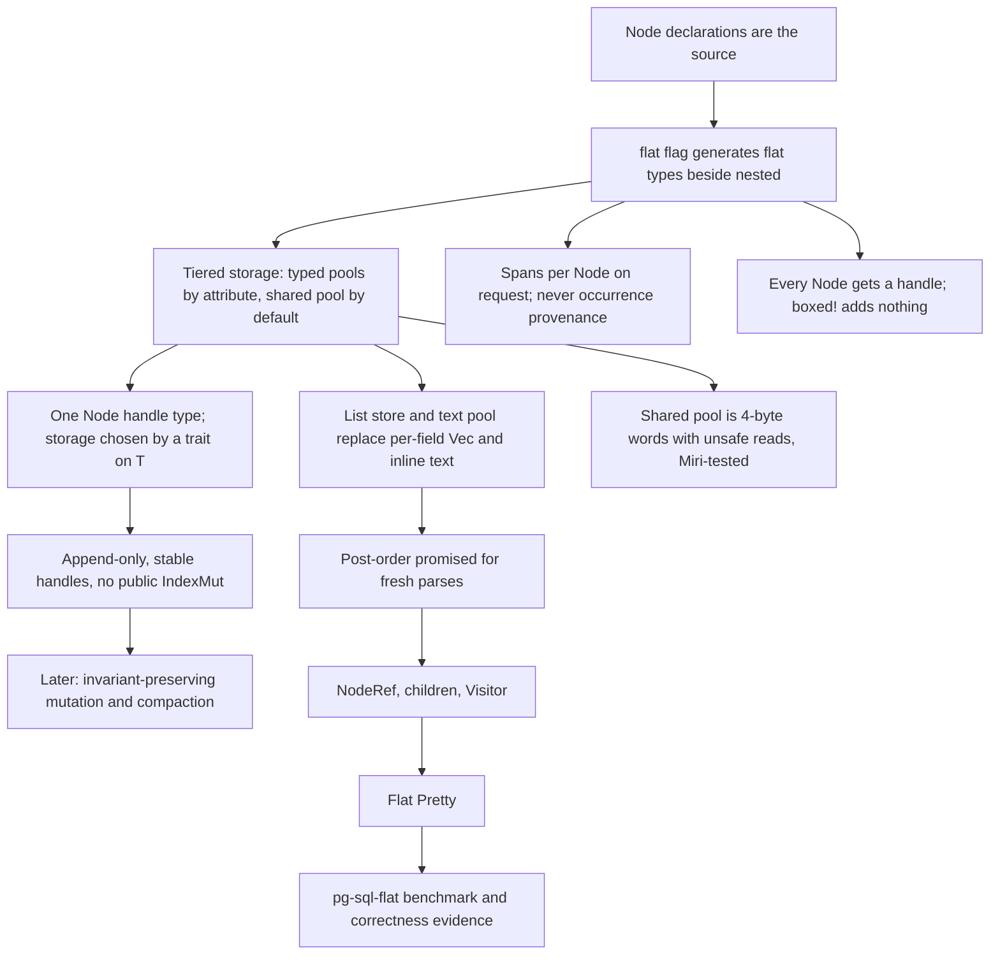

# Flat AST design

Status: tiered storage delivered on 2026-09-16. Steps 1 to 6 of the implementation order below
are done: storage, generated flat types, `parse_flat`, traversal, flat Pretty, and the pg-sql
`pg-sql-flat` benchmark entry with its correctness evidence. pg-sql now selects `flat` in both
`grammar!` blocks, pools `Expr`, `ColumnRef`, `FuncCall`, `SelectStmt` and `Statement`, and proves
nested/flat parity over the whole pinned corpus. Each parse pre-sizes its store from the token
count, which is a follow-up to step 3 recorded under [Construction](#construction). Two more
follow-ups landed on 2026-09-17: a finished result hands its stores to the next parse, and the text
pool releases borrowed texts without a per-entry drop walk. Both are recorded under
[Recycling](#recycling). Mutation and compaction are a later milestone.

Decisions: [ADR 0008](adr/0008-keep-flat-asts-semantic-only.md) (semantic-only, amended),
[ADR 0009](adr/0009-give-each-flat-ast-its-own-typed-stores.md) (per-result ownership, partly
superseded), [ADR 0010](adr/0010-declare-nodes-independently-of-ast-representation.md)
(declarations are the source), and [ADR 0012](adr/0012-tiered-flat-storage.md) (tiered
storage). Terms are defined in [CONTEXT.md](../CONTEXT.md).

## Purpose

A Flat AST is a second concrete representation of the same Node declarations that produce the
nested AST. It has three goals:

1. Nodes of a pooled Node type are contiguous in memory.
2. Every child relationship is a four-byte typed handle, not a pointer.
3. Only the Node types an author marks get a typed pool. Every other Node shares one pool.

Recursa generates the storage, the handles, the flat Node types, the construction from LR
reductions, the traversal primitive, and Pretty rendering. Consumer workloads such as name
resolution, type inference, and query rewriting are outside Recursa. They constrain the storage
API and they prove that it is sufficient, but their code does not live here.

## Scope of this milestone

In scope:

- Storage primitives in `recursa-core`, tested under Miri.
- The `flat` grammar-root flag and the `#[flat(...)]` declaration attribute.
- Generated flat Node types, handles, and layout assertions.
- Flat reduce actions and `parse_flat` entry points, with optional per-Node spans, built on the
  LR extent stack.
- `NodeRef`, `children`, `Visitor`, and a debug post-order checker.
- Flat Pretty rendering.
- The `pg-sql-flat` benchmark entry and correctness evidence.

Out of scope, deferred to a later milestone:

- The mutation API. The storage facts it depends on are fixed now (see [Mutation](#mutation)).
- Compaction.
- Flat Explorer support. `NodeRef` and `children` are designed so an adapter can be added.
- A flat `Visit` configured trait. It is a later layer over `children`. `VisitMut` cannot exist
  before the mutation API.

## Storage

One parsed result owns one Flat AST store. The store has four parts and every part is
append-only.

| Part | Contents | Handle |
| --- | --- | --- |
| Typed pool, one per pooled Node application | Every Node of that type, contiguous, in post-order | Node handle |
| Shared pool | Every Node not in a typed pool, as whole 4-byte words | Node handle |
| List store | Every list of handles, each list contiguous | List handle |
| Text pool | Every content token's text | Text handle |

```text
FlatAst<'input>
├── one typed pool per #[flat(pool)] application   (nodes, optional spans)
├── shared pool: Vec<u32>, word 0 reserved          (nodes, optional spans, debug tags)
├── list store:  Vec<u32>, slot 0 reserved          (runs of handles)
└── text pool:   Vec<ContentText<'input>>           (borrowed or owned text, optional spans)
```

### Which Nodes get a typed pool

The author decides per declaration:

```rust,ignore
ast_node! {
    #[flat(pool, max_size = 16)]
    pub enum Expr { /* ... */ }
}
```

- `#[flat(pool)]` puts every application of the declaration into its own typed pool. A generic
  Node gets one pool per materialized application.
- `max_size = N` adds a generated compile-time assertion that the flat Node type is at most `N`
  bytes. The assertion is opt-in. The size record is not. The generator emits `FLAT_NODE_SIZES` at
  the grammar root. It is a `&[(&str, usize)]` that holds the name and the `size_of` of every flat
  Node application, in parse-index order. A Node the root cannot name appears there too: it records
  its own size beside its declaration, and the table reads that constant. `size_of` is const, so a
  test can pin the whole table.
- A declaration without the attribute lives in the shared pool.
- `#[flat(...)]` in a grammar whose root does not enable `flat` is a diagnostic.

A type belongs in a typed pool when a consumer visits every instance, or keeps a dense side
table over it, or scans it linearly. Do not add a type to a pool without a measurement.

pg-sql's 1,463 declarations generate 1,479 flat Node types, one per materialized application.
Five carry `#[flat(pool)]`, which is the hot set a consumer walks or side-tables; the other 1,474
reach the shared pool. Measured sizes, on which only `FlatExpr` declares a bound:

| Flat type | `size_of` | Bound |
| --- | --: | --- |
| `FlatExpr` | 16 | `max_size = 16` |
| `FlatColumnRef` | 12 | — |
| `FlatFuncCall` | 8 | — |
| `FlatSelectStmt` | 20 | — |
| `FlatStatement` | 8 | — |

The bound is the measured size, not the measured size plus headroom, so widening a variant's
payload fails to compile and raising the bound is a deliberate edit. No declaration was
restructured to shrink a flat type; that is a later, measured decision.

### Handles

All handles are `#[repr(transparent)]` over `NonZeroU32`, so an optional handle is also four
bytes. They use `PhantomData<fn() -> T>` and implement `Copy`, `Eq`, `Hash`, `Debug`, `Send`,
and `Sync` by hand for every `T`. Raw construction is private to `recursa-core`.

- **Node handle** `Handle<T>`: one type for both pools. A generated trait impl on `T` selects the
  storage: for a pooled type the raw value is `slot + 1`; for a shared-pool type it is the word
  offset, which is never zero because word 0 is reserved. Field types do not change when a Node
  moves between pools.
- **List handle** `List<H>`: eight bytes, a non-zero start slot and a length. The empty run is a
  valid value distinct from an absent list. `one_or_many!` maps to a handle type whose length
  cannot be zero; `zero_or_many!` maps to one whose length can. `Option<one_or_many!>` stays
  distinct. `Option<zero_or_many!>` stays rejected.
- **Text handle** `Text<K>`: one text pool per result, typed by the content-token type `K`. The
  pool owns the `ContentText<'input>`, which borrows the input or owns replacement text. Nodes
  hold only the handle, so every flat Node is `Copy`. A consumer that wants interned symbols
  builds them from the text pool into its own table.

Text handles are data, not children. They do not appear in `NodeRef` or `children`.

### Field mapping

| Declaration | Flat field |
| --- | --- |
| `T` (Node) | `Handle<T>` |
| `boxed!(T)` | `Handle<T>` (boxing adds nothing in the flat style) |
| `Option<T>` | `Option<Handle<T>>` |
| `zero_or_many!(T)` | `List<Handle<T>>` |
| `one_or_many!(T)` | `List1<Handle<T>>` |
| `Option<one_or_many!(T)>` | `Option<List1<Handle<T>>>` |
| content token `K` | `Text<K>` |
| `#[presence(...)] bool` | `bool` |

Every Node application gets a handle. No Node is embedded inline in its parent. Named, tuple,
and unit shapes are preserved. Zero-size Nodes in the shared pool take one word; there is no
shared sentinel.

### Shared pool layout

The shared pool is a `Vec<u32>`. Every flat Node has alignment at most 4, because handles are
`u32`, list handles are two `u32`, and `Span` is two `u32`. The generator asserts
`align_of::<T>() <= 4` for every shared-pool Node and rejects a declaration that breaks it. A
Node occupies `ceil(size_of::<T>() / 4)` words, minimum one.

In debug and test builds the word before each Node holds a tag derived from the Node key, and
lookup checks it. Release builds omit the tag.

Reading a shared-pool Node casts an aligned pointer into the word buffer. This `unsafe` code is
confined to one storage module in `recursa-core`, with the typed handle as the only guard. The
value stack in the same crate is the precedent. The module's tests run under Miri in CI.

### Spans

Spans follow the existing request: with the `spans` feature on, `parse_flat` captures and
`parse_flat_without_spans` does not. When capture is on, every Node in both pools and every text
handle has a span. A pooled Node's span lives in a parallel array; a shared-pool Node's span is
written beside its words; a text handle's span comes from its token record. A parent's span is
the extent from its first child or token to its last. Capture off costs nothing.

Flat parsing never builds the occurrence tree. Mandatory occurrence sites do not apply to it.
This amends ADR 0008 from "no spans" to "no occurrence provenance; spans on request".

### Side tables

A side table is a consumer-owned dense array with one value per Node of one typed pool, indexed
by Node handle. Recursa provides the generic type and a `grow` operation; consumers own the
values. A side table cannot cover the shared pool, which is one reason to pool a type.

## Owner API

The generated owner is a grammar-local `FlatAst<'input>` with private fields.

- `root()` returns the root handle.
- `Index<Handle<T>>`, `Index<List<H>>`, and `Index<Text<K>>` are bounds-checked and panic out of
  range. `get(handle)` returns `Option`. No `IndexMut` and no mutable store access is public.
- `span(handle) -> Option<Span>` returns `None` when the parse did not capture. `has_spans()`
  reports the whole result.
- `pool::<T>()` borrows one pooled Node type's typed pool, whose `handles()` iterates its handles
  in post-order and whose `len()` sizes a side table. Only a pooled type has a pool.
- `lists()` and `texts()` borrow the list store and the text pool, read-only. `shared_words()`
  reports the shared pool's size, which is the only fact it can report: the pool names no element
  type a consumer could borrow.
- `root_ref()` returns the root as a `NodeRef`. It needs the generated `FlatNodeRef` bound on the
  root type, because the owner's root is a type parameter and only a trait can name its variant.
- The result is `Send + Sync`, checked at compile time.
- `recycle()` consumes the result and returns its stores for the next parse. See below.

### Recycling

A batch consumer parses one statement after another, and on a short statement the flat parser's
fixed cost is allocator calls rather than bytes. A finished result therefore hands its buffers on:

- `FlatAst::recycle(self) -> FlatBuffers` empties every store of the result and keeps its capacity.
  `FlatBuffers` is a grammar-local type at the grammar root. It holds every typed pool, the shared
  pool, the list store, the text pool, and the list scratch stack. It is `Send + Sync`, and
  `FlatBuffers::new()` starts empty, so a consumer can hold one value from its first parse onward.
- `FlatBuffers` borrows nothing. A live result's text pool borrows the input it was lexed from; an
  emptied pool holds no text, so `TextPool::into_recycled` drops the borrow and the buffers outlive
  that input. One buffer value therefore serves a whole batch of separately owned inputs. The
  lifetime erasure is one `unsafe` block in `recursa-core`'s storage module, guarded by an assertion
  that the buffer is empty, and it is covered by Miri.
- `parse_flat_reusing(input, buffers)` and `parse_flat_reusing_without_spans(input, buffers)` sit
  beside `parse_flat` on every application that has one. They return exactly what `parse_flat`
  returns. `buffers` is a `&mut Option<FlatBuffers>` slot rather than a value, which keeps
  `ParseError` and `?` unchanged: a successful parse empties the slot, because the result now owns
  the stores, and a failed parse puts the buffers back into it, emptied. A slot that is already
  empty makes fresh pre-sized stores, exactly as `parse_flat` does, so one call site serves the
  first parse and every later one.
- The builder clears each store, which applies the parse's own span-capture setting, and then
  reserves the same pre-sized capacity a cold parse reserves. A reservation a warm store already
  covers allocates nothing, so a recycled parse of a statement no larger than the last makes no
  allocation of its own. The result keeps the scratch stack for the same reason: without it the
  first list of the next parse would allocate.

Recycling ends the result it took the buffers from, which fixes one contract:

> Every handle of a recycled result is stale. The next parse hands the same handle values out for
> Nodes of its own, so a stale read reports another Node, or panics when the index is out of range
> or its shared-pool tag disagrees.

Consuming `self` stops a handle from outliving the result through the owner, and nothing can stop a
handle a caller copied out first: an index belongs to one result by contract, as
[ADR 0009](adr/0009-give-each-flat-ast-its-own-typed-stores.md) already says. Read what you need of
a result before you recycle it.

Measured on pg-sql, in a throwaway program that counts allocator calls around the parse call
alone. A short statement is `SELECT a, b FROM t WHERE c = 1;`; the wide one is the
`in_list_10000` stress fixture. Allocator calls per parse, without spans:

| Input | Cold flat | Warm flat (recycled) | Nested |
| --- | --: | --: | --: |
| short statement | 13.0 | 3.0 | 10.0 |
| `in_list_10000` | 14.0 | 3.0 | 21.0 |

A recycled parse allocates nothing for its stores. The three calls that remain are the LR run's own
scratch buffers, which are outside this milestone: the value stack's two vectors and the state
stack. The count is three for a 12-token statement and for a 10,000-element list alike, which is
what proves the stores allocate nothing.

The text pool carries one more cost that recycling exposed. A `ContentText` has drop glue, because
its owned variant holds a `Box<str>`, so dropping or clearing the pool walks every entry to check
each one's variant — and every text a parse stores borrows the input, so the walk never finds an
owned one. The pool therefore counts its owned texts, and at a count of zero it releases the
elements without the walk, in `clear` and in `Drop` alike. Miri covers both the borrowed and the
owned case.

Measured on the same program, with the fast path forced off and then on. The wide input's text pool
holds 10,001 texts; the short statement's holds five:

| Input | Operation | Walk | Fast path |
| --- | --- | --: | --: |
| `in_list_10000` | drop the result | 5.05 µs | 0.64 µs |
| `in_list_10000` | recycle the result | 4.17 µs | 0.13 µs |
| short statement | drop the result | 0.14 µs | 0.14 µs |
| short statement | recycle the result | 0.06 µs | 0.06 µs |

The wide input's destruction is 6 to 30 times cheaper, and what remains is freeing the buffers
themselves. A short statement has too few texts to measure, which is the expected result: the walk
costs one branch per text.

## Construction

Flat reduce actions run on the existing LR automaton, tables and value stack. They push handles,
not values. A flat action pops and pushes exactly as many values as the nested action of the same
rule, so the packed `value_pops` table serves both and the two dispatchers cover the same rules.
A parent is reduced after its children, so every typed pool is in post-order for a fresh parse.
This is a documented contract: for every Node in a typed pool, every same-pool child has a
smaller index. A debug checker walks `children` over every Node and asserts it.

`Type::parse_flat` and `Type::parse_flat_without_spans` exist beside `parse` for every Node
application that has one. They return the grammar's own `FlatAst` rooted at that application's
flat type. Both run the same automaton loop as `parse`, so diagnostics, prefix acceptance and
consumed input are identical, and a failure restores the input cursor and drops every store.
`boxed!` disappears from the flat actions: every child is already a handle.

A flat parse pre-sizes its store. The lexer has already counted the tokens, so
`ParseContext::remaining_tokens` is an upper bound on the tokens the parse can consume, and the
generated builder turns that count into one capacity per store. The multipliers are measured, not
guessed: they come from the final size of each store over pg-sql's 43,246 pinned corpus statements
and its 16 stress fixtures. The generator declares them as named constants that record the
measurement. They reserve eight shared-pool words per token (measured median 4.13, 90th percentile
7.17), one list-store slot per token (median 0.40, 90th percentile 0.67), one text per two tokens
(median 0.33, 90th percentile 0.50), and one Node per four tokens in every typed pool (the widest
pool's median is 0.14 and its 90th percentile 0.43). The three word-and-slot stores take the 90th
percentile because a `u32` of slack is cheap; a typed pool takes roughly its median because a flat
Node is several words wide and one estimate serves every pool. A floor of sixteen entries keeps a
one-token input from reserving a capacity its first writes outgrow. A typed pool reserves nothing
at all when its estimate falls below sixteen Nodes, because pg-sql's median statement leaves three
of its five pools empty and five speculative allocations cost more than the lazy growth of the two
it uses. Every capacity is a hint: a store that outgrows it grows as it always did, so the
reservation changes no stored value. Measured on the pinned corpus, the median statement went from
seven reallocations to none, 72.9% of statements now reach zero reallocations across every store
(from 0%), and the mean fell from 6.75 to 0.37 per statement.

Lists are built on one scratch stack owned by the parse. Each list-step reduce pushes one
handle; when the parent rule consumes the list, the action copies the run into the list store
and truncates the scratch stack. This works because LR completes an inner list before the outer
list receives its next item, so open lists nest.

Content-token reduces push the token's text into the text pool and return a text handle.

A fixed-token unit Node carries no value on the value stack, in the flat path exactly as in the
nested one. Its parent allocates it and keeps the handle.

Exhausting a handle's `u32` range is a checked panic with a clear message in every build, as ADR
0009 requires. It is distinct from allocation failure.

### The extent stack

Per-Node spans come from one runtime fact a later step must keep. When a parse tracks extents,
and only then, the LR loop keeps a stack of source extents parallel to its state stack: a shift
pushes the shifted token's span, and a reduce replaces its popped frames' extents with the extent
that covers them, so the goto frame carries the extent of the whole rule. A frame that covers no
token holds `Span::SYNTHETIC` and merging skips it. A reduce action reads `Reduction::extent` for
its own rule and `Reduction::symbol_extent` or `Reduction::symbol_range_extent` for one
right-hand-side symbol, which is how a parent gives an allocated unit Node a span.

Only a flat parse asks for extents. The request that asks for them is the one that suppresses
occurrence provenance, so the two never run together and nested parsing allocates no extent
stack and behaves exactly as before.

## Traversal

The generator emits, at the grammar root beside the owner:

- `NodeRef`: an enum with one variant per publicly materialized Node application, each holding
  that application's handle. It is a traversal value only and is never stored in a Node. The
  variant name is the declaration's name followed by the name of each type argument, so
  `Holder<Name>` is `HolderName`; two applications that would share a name both take their
  canonical parse index as a suffix. `NodeRef::name()` returns the variant's own name.
- One `Opaque` variant, only for a grammar in which a public Node has a child the root cannot
  name. Such a child is a Node declared without `pub`, or a Node in a private module. The variant
  holds an `OpaqueRef`, which carries the child's raw handle and a `&'static OpaqueTable`. The
  table holds the Node's name and a children function. The generator emits the table in the Node's
  own module, which is the one module that can name the Node. `NodeRef::name()` returns that name.
  `children` reports the opaque Node's own children too, so no subtree is truncated. Every Node of
  a result is therefore reachable from its root. The table's children function takes the shared
  pool, the list store and the raw handle, and nothing else. It needs no typed pool, because a Node
  the root cannot name is always in the shared pool.
- `children(ast, node, &mut impl FnMut(NodeRef))`: a free function that calls the sink once per
  direct child in source order. A text handle and a presence flag are data, never children. A wide
  match is split into bounded helper functions, as a wide Visit match is, so a pg-sql-scale
  grammar typechecks as a series of small functions. A split leaf whose applications all have no
  children is the `Pat => true, _ => false` shape `clippy::match_like_matches_macro` rewrites, so
  the generated-code lint policy covers that lint; nothing downstream can edit a generated match.
- `FlatNodeRef`, which names one flat type's own variant, and the owner's `root_ref` built on it.
- `check_post_order(ast)`, which walks `children` over every Node of every typed pool and returns
  the first same-pool child that does not precede its parent. A fresh parse always passes, so the
  call is cheap evidence for invariant I1 in a test or a debug build. An opaque Node is never
  pooled, so the checker reads none of them. It reaches a pooled Node below one through the pool
  itself.

`recursa-core` owns the grammar-erased half, so one walk serves every grammar and an adapter can
reuse it:

- `FlatChildren`, with the grammar's `NodeRef` as its associated type, implemented by the
  generated owner. Its sink is a trait object, so the traversal compiles once per grammar.
- `FlatVisitor`, with `enter`, which returns `false` to skip children, and `leave`. `leave` runs
  for a skipped Node too, so the two calls always pair.
- `walk`, which is iterative: it keeps its own stack on the heap and reuses one child buffer, so
  the depth of the Flat AST does not bound it.

Parent links are not stored. A consumer that needs them builds a side table on demand.

## Pretty

Flat Pretty is generated from grammar syntax and declarative Pretty annotations, as the earlier
milestone settled. It does not reuse handwritten nested implementations. An edited Flat AST
renders to SQL that reparses to the same semantic tree; whitespace and comment fidelity are not
required.

One renderer serves both representations. The generator renders a Node's nested body and its flat
body from the same frozen Pretty behavior, so spacing, breaks, groups, separators, `#[pretty(...)]`
hints, presence and declared-precedence parenthesization cannot drift apart. Two things differ, and
nothing else does:

- **Value access.** A flat Node is `Copy` and holds each child as a handle, so a field access is
  spelled exactly as the nested one. The `Box` layer disappears, because the field mapping already
  dropped it.
- **Child dispatch.** A nested child renders itself. A flat child is a Node handle, an optional
  handle, a list handle or a text handle, and only the result's stores can resolve one.

The contract is an equality: for one input, `FlatAst::render` returns exactly what the detached
nested AST of the same input returns. Neither value carries occurrence provenance, so both emit the
canonical spelling of every fixed token, omit optional fixed syntax that only provenance could
report, and read a content token's spelling from stored text — the text pool for the Flat AST, the
token value for the nested one.

The rendering surface on the owner is:

- `pretty(&self, context)` renders the Node at `root()`.
- `render()` renders with the grammar's selected layout and `render_with(config)` with a caller's.
- `pretty_node(handle, context)` renders any Node of the result, which is how a consumer renders
  one subtree.

The protocol behind them is [`FlatPretty<S>`](../recursa-core/src/flat_pretty.rs) in
`recursa-core`: one public trait whose `pretty_in` takes the store beside the value. The generator
implements it once per flat Node type, beside the declaration, so a Node declared without `pub`
renders too. One generated container trait resolves every handle shape a field can hold, which is
what keeps the rendering code above it identical for both representations. A declared-precedence
operand is resolved through the store before its grouping decision is made, because that decision
reads the operand's own variant.

Evidence is the `flat-pretty` generation fixture: every positive input of the container grammar is
parsed twice and the two renders are asserted equal, each flat render reparses to the same flat
document and the same nested semantic tree, and the mutation cases cover declared-precedence
parenthesization and a grammar that selects `arena_ast` beside `flat`.

## Mutation

The API is deferred until parsing works. Three storage facts are fixed now because they are hard
to retrofit:

1. Pools, the list store, and the text pool are append-only. A replaced Node leaves its old
   storage in place.
2. Handles are stable for the life of the result. No slot is removed, reused, or compacted in
   this milestone.
3. Compaction, when it arrives, is a copying pass into a fresh store that restores post-order
   and returns a remap per typed pool.

Public `ast[handle] = node` is ruled out. It would allow a cycle or a second parent in one line.
The eventual API must make cycles, multiple parents, and invalid handles impossible by
construction, as ADR 0009 requires.

## Invariants

| ID | Invariant | Enforced by |
| --- | --- | --- |
| I1 | In a fresh parse, every same-pool child of a pooled Node has a smaller index. | LR reduce order; debug checker over `children`. |
| I2 | Every handle refers to the store that created it. | API contract; raw construction is private. |
| I3 | For every shared-pool handle, a Node of that type was written at that word. | Typed handle; debug tag. |
| I4 | Every slot of a list run was written from the run's handle type. | The list store is the only writer. |
| I5 | A typed pool and its span array, when present, have equal length. | The pool is the only writer. |
| I6 | Every shared-pool Node has alignment at most 4. | Generated assertion. |
| I7 | A pooled Node with `max_size` is at most that size. | Generated assertion. |
| I8 | A side table has the same length as its pool when read. | `grow` after each append. |

## Design tree



## Implementation order

1. Storage primitives in `recursa-core`: handles, typed pool, shared pool, list store, text
   pool, side table. Unit tests and Miri. Done.
2. The `flat` root flag, the `#[flat(...)]` attribute, and generated flat types with size and
   alignment assertions. Done.
3. Flat reduce actions and `parse_flat`, with the scratch list stack and optional spans. Done.
4. `NodeRef`, `children`, `Visitor`, and the post-order debug checker. Done.
5. Flat Pretty. Done.
6. The `pg-sql-flat` bench entry and correctness evidence. Done.
7. Later milestone: mutation API and compaction.

## Correctness and performance acceptance

- Cover every supported field shape, generic applications, module and type identities, and
  generated Pretty with representative Recursa fixtures.
- Compare nested and flat recognition, consumed input, and diagnostics, including failure
  cleanup. Both paths stay available with `flat` and `arena_ast` enabled together.
- Prove flat-to-SQL-to-nested semantic equivalence.
- Check `Send + Sync`, four-byte optional handles, eight-byte optional list handles, and every
  `max_size` and alignment assertion at compile time.
- Check the handle capacity guard without allocating billions of Nodes.
- Run the post-order checker after every fresh parse in tests.
- Run the storage module under Miri.
- Keep the existing pg-sql differential suite as correctness evidence.

### Benchmark

The `parse` target in `../pg-sql/benches/parse.rs` carries the engine name `pg-sql-flat` beside
`pg-sql`, `sqlparser`, and `postgres`, under the same timing boundary: lexing, parsing, and
destruction inside each call, identical inputs, no prelexed input for the flat entry alone. The
probe asserts nested and flat acceptance agreement over every statement it looked at and aborts
with a listing before any timing is taken, so a flat-only rejection cannot hide behind the
exclusion filter.

```sh
cargo bench -p pg-sql --features postgres-oracle --bench parse
```

Run twice on 2026-09-16, before and after the store was pre-sized from the token count. The
harness wrote its reports to `pg-sql/docs/benchmarks/2026-09-16T09-21-17Z-7ea2355/` and
`pg-sql/docs/benchmarks/2026-09-16T13-19-22Z-e875a61/`, which are local run artifacts: those
directories are gitignored, so the numbers that matter are reproduced here. Both runs cover 238
benchmarks, 33,708 statements timed by all four engines, and in both the two representations
rejected exactly the same 180 statements.

| Engine | Total median time, pre-sized | vs pg-sql | Total median time, before | vs pg-sql |
| --- | --: | --: | --: | --: |
| pg-sql (nested arena AST) | 92.153 ms | 1.00× | 90.092 ms | 1.00× |
| pg-sql-flat (Flat AST) | 79.499 ms | 1.16× | 84.876 ms | 1.06× |
| postgres (PostgreSQL 17.9 raw parser) | 44.117 ms | 2.09× | 43.184 ms | 2.09× |
| sqlparser | 200.588 ms | 0.46× | 194.852 ms | 0.46× |

Per benchmark the flat entry now ranges from 0.94× to 1.43× of the nested entry, median 1.12×,
where before pre-sizing it ranged from 0.86× to 1.41×, median 1.02×. The loss is now on 3 of the
237 timed benchmarks, where it was on 54: almost every benchmark that lost by the fixed setup
either won or came back to parity. The short DDL files the earlier run named recovered most of
the gap: `create_schema` 0.86× to 0.95×, `create_role` 0.87× to 0.98×, `reindex_catalog` 0.89×
to 0.94×, and `drop_if_exists` 0.91× to 1.00×. The large corpus files gained too, `aggregates`
1.01× to 1.12×. The stress shapes, whose stores already amortized their growth, gained a little
more: `select_list_10000` 1.41× to 1.43×, `in_list_10000` 1.38× to 1.43×, and `bool_chain_1000`
1.29× to 1.32×. Deep subquery nesting turned from a loss into a win, `nested_subquery_15` 0.98×
to 1.07×. No declaration was restructured; that is a separate, later decision.

The engine list stays as it is. The benchmark's model is parse-from-scratch inside the timing
boundary, so a warm-reuse entry would be a different engine rather than a faster one, and
recycling is measured by allocation count instead.

The "everything in the shared pool" variant is an opt-in experiment made by removing the pool
attributes. It is not a third engine name and not an acceptance condition. A measured speedup is
not an acceptance condition; correctness and an honest report are.

## History

The earlier milestone design gave every Node type its own `Vec` store, kept content-token text
inline, and planned a bumpalo comparison ([allocation research](flat-ast-allocation-research.md)).
At pg-sql's scale, 1,463 declarations, that is roughly 35 KB of empty vectors per result and one
allocation per type touched, and the research found that per-field child vectors survive
flattening. Tiered storage, the list store, and the text pool answer those findings. The
`ast_node!` migration ([Node declarations](ast-node-declarations.md)) made the flat types
derivable from the same source as the nested types.
